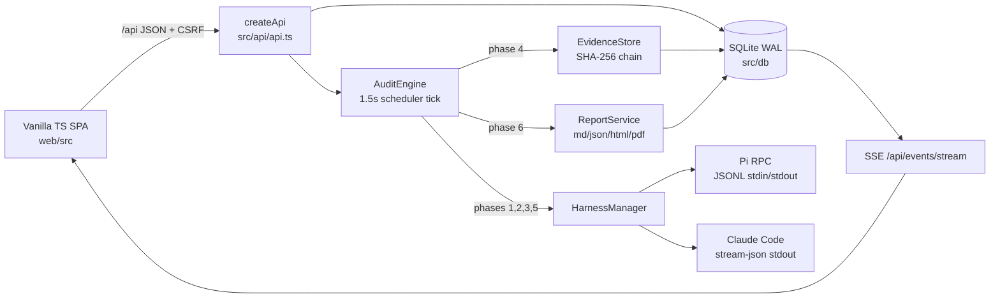

# Repository Guidelines

Argus (`argus-audit`, v0.0.2) is a self-hosted source-code security audit workspace. It imports an authorized repository snapshot, maps it, discovers candidate vulnerabilities, confirms them in independent harness sessions, persists evidence-backed findings, re-verifies them, and exports deterministic reports. Bun + strict TypeScript + SQLite + a vanilla TypeScript SPA. AGPL-3.0-only.

Deeper references: `docs/ARCHITECTURE.md`, `docs/API.md`, `docs/DATABASE.md`, `docs/HARNESSES.md`, `docs/SECURITY.md`, `docs/DECISIONS.md`.

## Project Overview

- **Audit workflow, not a chat wrapper.** Six explicit phases with durable task rows, barriers, retries, caps, cancellation, and budgets. The orchestrator owns phase decisions; it never sends the whole workflow as one prompt.
- **Evidence is the product.** A finding needs a source quote that matches the imported snapshot and appears on an affected file. Two agreeing models are not sufficient.
- **Determinism where it matters.** Phase 4 (finding persistence) and Phase 6 (reports) are code, not model calls. Reports read only the database.
- **Independence.** A discovery session cannot validate its own candidate; retest uses a fresh session, and optionally a distinct harness.
- **Fail closed.** No silent harness substitution, no permission-bypass flags, read-only workspaces by default, missing prerequisites produce classified task failures.
- **Single-process coordinator.** SQLite is the source of truth; the UI never fabricates task, finding, harness, or report state.

## Architecture & Data Flow

### Process and HTTP

`scripts/start.ts` validates Bun, port, and the built dashboard, then imports `src/server.ts`. `server.ts` builds the single object graph (`Store`, `AuthService`, `EventLog`, `HarnessManager`, `EvidenceStore`, `ReportService`, `LocalCatalog`, `AuditEngine`) and calls `Bun.serve`. There is no DI container and no router table: `src/api/api.ts` dispatches with a linear `path ===` / `path.match` chain, delegating `/api/skills` and `/api/mcp` to `src/api/local-resources.ts`.

Request order: parse URL → public routes (`/api/health`, `POST /api/auth/login`) → cookie session (`argus_session`) → CSRF header `x-csrf-token` for non-GET → per-route `requireUser` / `requireRole`. Roles are `viewer < auditor < admin`. Success bodies vary by endpoint; errors are always `{ error: { code, message, details } }` from a thrown `AppError`. SSE is live notification only — pages refetch via REST.

### Audit pipeline

| Phase | Task kind | Executor | Persisted output |
|---|---|---|---|
| 1 | `phase1.map` | `mapper` agent | architecture map, areas, coverage matrix |
| 2 | `phase2.discover` per area | `security_researcher` | candidates with excerpts and checks |
| 3 | `phase3.confirm` per candidate | `independent_validator` | append-only verification row, candidate verdict |
| 4 | `phase4.persist` per confirmed candidate | deterministic | finding + evidence records |
| 5 | `phase5.reverify` per finding | `retest_auditor` | append-only reverification row, finding status |
| 6 | `phase6.report` | deterministic | four report records and files |

A scheduler tick every 1.5s reconciles barriers and claims eligible tasks with `UPDATE ... WHERE status='queued'`, so duplicate execution is prevented without a distributed lock. Concurrency is clamped by global (`ARGUS_MAX_AGENTS`, default 4), audit, project, and role limits. Retries are immediate requeues with attempt counters; classified errors (`harness_missing`, `budget_exceeded`, `cancelled`, policy denials) are not retryable. Phase 6 waits for phases 3–5 and is rebuilt if a later retest stales it.

### Harnesses

`HarnessManager` builds a `PiHarnessAdapter` or `ClaudeCodeHarnessAdapter` from persisted config plus decrypted credentials. Harness kind is explicit per role (or audit override); there is no fallback. Pi uses strict newline-delimited JSON over stdin/stdout and completes on `agent_settled`; Claude Code uses `-p ... --output-format stream-json --json-schema` and completes on `result`. Both run through `src/harness/sandbox.ts`: Bubblewrap when available, otherwise `workspace-copy` with a recorded warning. Adapters normalize text/thinking/tool/usage/error events; the engine validates agent JSON against hand-rolled schemas from `src/orchestrator/schemas.ts` before use.

### Evidence and reports

`EvidenceStore` appends `sha256(content)`, `prev_hash`, and `chain_hash = sha256(prev:contentHash:kind:title)`; evidence JSON is written mode `0600` under `dataDir/evidence/<auditId>/` and database rows are append-only. The quote gate reads the imported snapshot (never the agent workspace), normalizes whitespace, requires at least 12 characters, requires the path to be in scope, and downgrades `CONFIRMED`/`REVERIFIED` when no affected-file excerpt verifies. Reports are built from the database in Markdown, JSON, HTML, and PDF; PDF uses headless Chrome with a dependency-free text-PDF fallback.

### Frontend

Hand-rolled DOM with the `h()` hyperscript helper (`web/src/ui.ts`), hash routing (`#/route/id`), and static page imports in `web/src/main.ts`. Every page exports `async function renderX(root)` that replaces its container using the `loading` → `api()` → `errorState` idiom. All requests go through `web/src/api.ts` (same-origin cookies, CSRF on mutations, `ApiError`). One `EventSource` (`/api/events/stream`) triggers a 1100ms debounced refetch; SSE is not the source of truth.

## Key Directories

| Path | Contents |
|---|---|
| `src/api/` | API dispatch, HTTP/JSON/error helpers, SSE, Skills/MCP routes |
| `src/orchestrator/` | `AuditEngine` state machine, prompts, schemas, evidence gate and hash chain |
| `src/harness/` | Pi and Claude Code adapters, process lifecycle, sandbox, session resources |
| `src/repo/` | Authorized import, inventory/scope matching, per-session workspace copies |
| `src/reports/` | Report data assembly, Markdown/JSON/HTML, Chrome and fallback PDF |
| `src/local/` | On-disk Skill and MCP discovery plus the persisted catalog |
| `src/security/` | AES-256-GCM credential vault, secret redaction |
| `src/db/` | `Store` query helper and versioned migrations |
| `web/src/` | Dashboard source: `main.ts`, `ui.ts`, `api.ts`, `pages/`, `components/` |
| `test/` | Bun test suite and the deliberately vulnerable fixture app |
| `scripts/` | Start, dashboard build, real end-to-end demo, local checks, scope benchmark |
| `deploy/` | Dockerfile and Compose deployment |

## Development Commands

| Command | Purpose |
|---|---|
| `bun install --frozen-lockfile --ignore-scripts` | Install the (dev-only) locked toolchain |
| `bun run dev` | Watch-mode server on `127.0.0.1:8787`; does **not** rebuild the dashboard |
| `bun run build` / `bun run build:web` | Bundle `web/src/main.ts` into `web/dist` with hashed assets |
| `bun run check` | `tsc --noEmit` then the five-file test suite — the required gate |
| `bun run typecheck` | Type gate only |
| `bun run test` | Full suite; `bun test test/engine.test.ts` for one file |
| `bun run start` | Foreground production-style server; requires `web/dist` |
| `bun run harness:check` | Real Pi/Claude detection + health checks; can spend credits |
| `bun run e2e` / `bun run demo` | Real dual-harness audit of the fixture; needs both CLIs and provider credentials |
| `bash -n install.sh start.sh` | Shell syntax check required before a PR |

Before handing off a change: `bun run check && bun run build && bash -n install.sh start.sh`. After any `web/src` change, rebuild and reload the browser; editing `web/dist` is pointless because the build deletes `web/dist/assets`.

## Code Conventions & Common Patterns

**Modules and types**

- ESM only, `"type": "module"`, relative imports with explicit `.ts` suffixes (`import { loadConfig } from "./config.ts"`). No path aliases.
- Bun built-ins over npm: `bun:sqlite`, `bun:test`, `Bun.serve`, `Bun.spawn`, `Bun.password`, `Bun.file`. Runtime dependencies are intentionally empty; do not add a framework or query builder without a documented decision.
- Strict TS with `noUncheckedIndexedAccess` and `noImplicitOverride`. Narrow indexed access instead of casting.
- Files: kebab-case (`evidence-gate.ts`). Classes/factories: PascalCase (`AuditEngine`, `createApi`). Functions/variables: camelCase. Database columns and JSON fields: snake_case. Event types and setting keys: dotted (`agent.tool_start`, `audit.max_areas`).

**Errors and API**

- Throw `AppError` (or `Error`) and let `createApi` map it once; there is no `Result` type on the HTTP path. Helpers `badRequest`, `unauthorized`, `forbidden`, `notFound`, `conflict` live in `src/api/http.ts`.
- Agent output is the exception: `validateAgainstSchema` returns `{ ok: true } | { ok: false }` because failures are classified task outcomes, not HTTP errors.
- Validate and authorize before doing work (`assertAuthorizedRoot`, role checks, approval checks). Fail closed on missing settings or approvals.
- Never log or return secrets. Redact through `src/security/redact.ts` before events, task errors, and reports. The vault decrypts only into the harness child environment; API responses expose `last4` only.

**Persistence**

- Use `store.get/all/run/changes(sql, ...params)` and `store.transaction(fn)` with positional `?` placeholders. SQLite calls are synchronous; transaction callbacks must stay synchronous.
- Migrations are ordered, transactional, forward-only, and applied once. Never edit an applied migration — append a new `{ version, name, sql }` entry. Current versions are 1 and 2.
- Evidence, verifications, and finding provenance are append-only via triggers. Do not update/delete those rows; add new records.
- Store timestamps as ISO strings from `now()`, booleans as INTEGER 0/1, and JSON as `TEXT` via `toJson`/`parseJson`.

**Async and concurrency**

- Entrypoints use top-level `await`; background work is `void promise.catch(console.error)`.
- Use `KeyedSerialQueue` (`src/concurrency.ts`) to serialize per-audit work such as transitions and evidence appends. Use `Semaphore` (`src/util.ts`) for slot accounting.
- Task claims are conditional updates, not locks. Keep the single-process assumption; clustered execution is explicitly out of scope.
- Put timeouts on every subprocess. The process helper escalates SIGTERM → SIGKILL.

**Orchestrator and harness changes**

- Phase handlers belong in `AuditEngine`; prompts are functions in `src/orchestrator/prompts.ts`, and structured output contracts are hand-rolled JSON Schemas in `schemas.ts`.
- A new harness implements `HarnessAdapter` (`detect`, `health`, `capabilities`, `run`, `cancel`, `cleanup`) and is selected by explicit kind. Preserve native harness loops; do not emulate them.
- Emit lifecycle events through `EventLog.append` so the audit stream and history stay complete. Do not invent state in the UI.
- Quotes must be verified against the imported snapshot, not the workspace copy. Evidence `kind`, `title`, and content are part of the hash chain; changing them breaks verification.

**Frontend**

- Build DOM with `h()`/`append`/`section`/`field` helpers; do not introduce `innerHTML` with untrusted data.
- Add pages as `renderX(root, id?)`, register them in the `renderRoute` switch and `NAV_GROUPS`, and keep all data from REST.
- Follow the `loading` → fetch → `errorState(message, retry)` pattern; surface API errors instead of swallowing them.
- Use existing badge/tone classes and `styles.css` custom properties; the UI is responsive and keyboard-accessible, with `:focus-visible` and reduced-motion handled globally.

## Important Files

| File | Role |
|---|---|
| `scripts/start.ts` | Runtime/port/asset preflight, `ARGUS_HOST` default, imports the server |
| `src/server.ts` | Process composition, `Bun.serve`, static/SPA fallback, security headers, shutdown |
| `src/config.ts` | `ARGUS_*` env parsing, cookie name, phase names, data directories |
| `src/api/api.ts` | All `/api` routes except Skills/MCP; auth/role/CSRF enforcement |
| `src/api/http.ts` | JSON responses, `AppError` mapping, body parsing and limits |
| `src/api/sse.ts` | Shared SSE framing, heartbeat, replay |
| `src/auth.ts` | Argon2id users, cookie sessions, CSRF tokens, login lockout, audit log |
| `src/db/index.ts` | SQLite connection, pragmas, migration runner, query helpers |
| `src/db/migrations.ts` | Schema versions and append-only/immutability triggers |
| `src/orchestrator/engine.ts` | Audit/task state machine, scheduler, retries, budgets, phase fan-out |
| `src/orchestrator/evidence-gate.ts` | Quote normalization and affected-file verification |
| `src/orchestrator/evidence.ts` | Per-audit hash-chained evidence append/verify |
| `src/orchestrator/schemas.ts` | Agent JSON contracts and validator |
| `src/harness/manager.ts` | Harness selection, caching, detection, credential env |
| `src/harness/pi.ts`, `src/harness/claude.ts` | Real adapter command lines and stream parsing |
| `src/repo/import.ts`, `src/repo/workspace.ts` | Authorized snapshots and read-only session copies |
| `src/reports/generator.ts` | Deterministic four-format report generation |
| `src/local/discovery.ts` | Skill/MCP config discovery and normalization |
| `web/src/main.ts` | SPA entry, route table, auth shell, SSE refresh |
| `web/src/api.ts` | Fetch wrapper, CSRF, `ApiError`, unauthorized event |
| `web/src/ui.ts` | DOM helpers and shared UI primitives |

## Runtime/Tooling Preferences

- **Bun only.** `engines.bun >= 1.3.14`, `packageManager bun@1.3.14`. CI and Docker pin 1.3.14. Do not introduce a Node entrypoint or `ts-node`.
- **Type gate is `tsc --noEmit`.** There is no ESLint, Biome, Prettier, or EditorConfig. Match existing formatting.
- **Dashboard output.** `web/dist/` is generated and gitignored; a local build currently exists. Never hand-edit it.
- **Trusted data.** `data/`, `demo-output/`, `tasks/`, `.env*`, SQLite files, `master.key`, and `bootstrap-admin.txt` are ignored local state. Do not commit them or copy them into fixtures.
- **Servers and paths.** Defaults: port `8787`, host `127.0.0.1` via `start.ts` (`0.0.0.0` in `loadConfig` and Docker), data `./data`, web assets `web/dist`. `ARGUS_ALLOWED_ROOTS` is colon-separated and always includes `<dataDir>/repos`.

Common environment variables (full list in `.env.example` and `src/config.ts`):

| Variable | Default | Notes |
|---|---|---|
| `ARGUS_PORT` / `ARGUS_HOST` | `8787` / `127.0.0.1` via `start.ts` | Docker uses `0.0.0.0` |
| `ARGUS_DATA_DIR` | `./data` | SQLite, evidence, reports, snapshots, workspaces, keys |
| `ARGUS_ALLOWED_ROOTS` | repo root + `<dataDir>/repos` | Import scope boundary |
| `ARGUS_ADMIN_EMAIL` / `ARGUS_ADMIN_PASSWORD` | `admin@argus.local` / random file | Password file is `bootstrap-admin.txt`, mode 0600 |
| `ARGUS_SESSION_TTL_HOURS` | `12` | Session lifetime |
| `ARGUS_MAX_AGENTS` | `4` | Global agent concurrency seed |
| `ARGUS_SANDBOX` | `auto` | `auto`, `bwrap` (fails closed), `none` |
| `ARGUS_PI_BIN` / `ARGUS_CLAUDE_BIN` | `pi` / `claude` | External CLIs, never installed by the app |
| `ARGUS_MASTER_KEY` | unset → `dataDir/master.key` | AES key material for provider credentials |
| `ARGUS_SECURE_COOKIES` | `0` | Set `1` behind TLS |

- External requirements for real audits: Pi and/or Claude Code plus provider credentials; Chrome only for PDF rendering and UI checks. Missing harnesses fail tasks, not the server.
- Deployment: `install.sh` supports Linux/macOS/WSL2 and preserves data across reinstall; Docker runs `bun run src/server.ts` with sandbox `none`, `/data` volume, and mandatory `ARGUS_ADMIN_PASSWORD`.

## Testing & QA

- Runner is `bun:test`; the suite is exactly the five files listed in `package.json` `scripts.test`. A new `test/*.test.ts` must be added there or it will not run in CI.
- Tests use temporary directories and private SQLite files (`new Store(config, "test.sqlite")`), close the store, then delete the directory. No test calls a model or the network.
- `test/engine.test.ts` drives the real six-phase state machine with `fakeManager()`, scripted per-role JSON, and the `test/fixtures/vulnerable-app` snapshot. Extend the scripted results instead of invoking Pi/Claude.
- The fixture is intentionally vulnerable (hardcoded JWT secret, SQL concatenation, IDOR, command injection, path handling, error leakage, prompt-injection README text). Never deploy it; never "fix" it.
- Test names are complete sentences; group with `describe`, assert with `expect`. Cover behavior changes with a regression test.
- Local manual QA: run `bun run build && bun run start`, then inspect the affected flow at desktop and mobile widths. `bun run scripts/ui-smoke.ts` needs `ARGUS_ADMIN_PASSWORD` plus system Chrome, signs in, and fails on page or console errors; `bun run scripts/check-local-resources-ui.ts` also needs Chrome and flags horizontal overflow at 320/768/1024/1440. `bun run scripts/check-local-mcp.ts` exercises Pi's MCP adapter without a provider call.
- CI (`.github/workflows/ci.yml`) runs on Ubuntu and macOS with Bun 1.3.14: frozen install, `bash -n install.sh start.sh`, `bun run check`, `bun run build`. The real-harness e2e is excluded.
- No coverage threshold or skip markers exist. Do not add `.only` or silently skip tests.

**Change checklist**

1. Preserve the security invariants: role checks, quote verification, session independence, cancellation, redaction, no silent fallback.
2. Add a forward migration for schema changes; never rewrite evidence or verification history.
3. Update `docs/` when behavior, API shape, configuration, or harness commands change.
4. Run `bun run check`, `bun run build`, and `bash -n install.sh start.sh`; smoke the changed surface.
