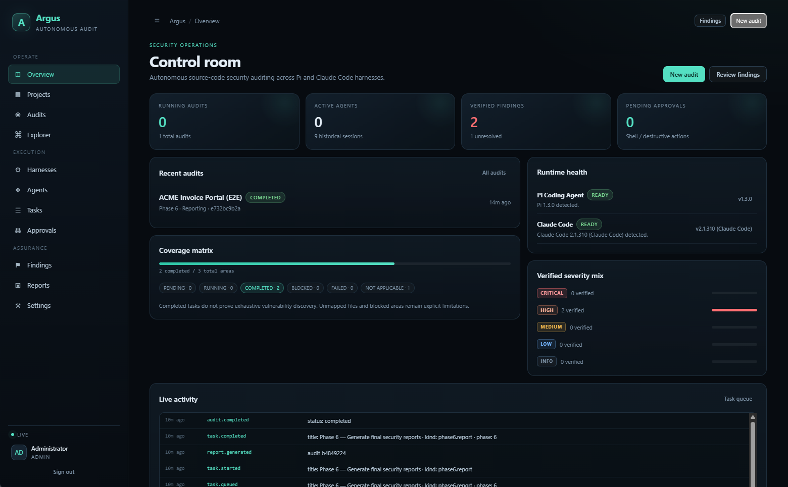
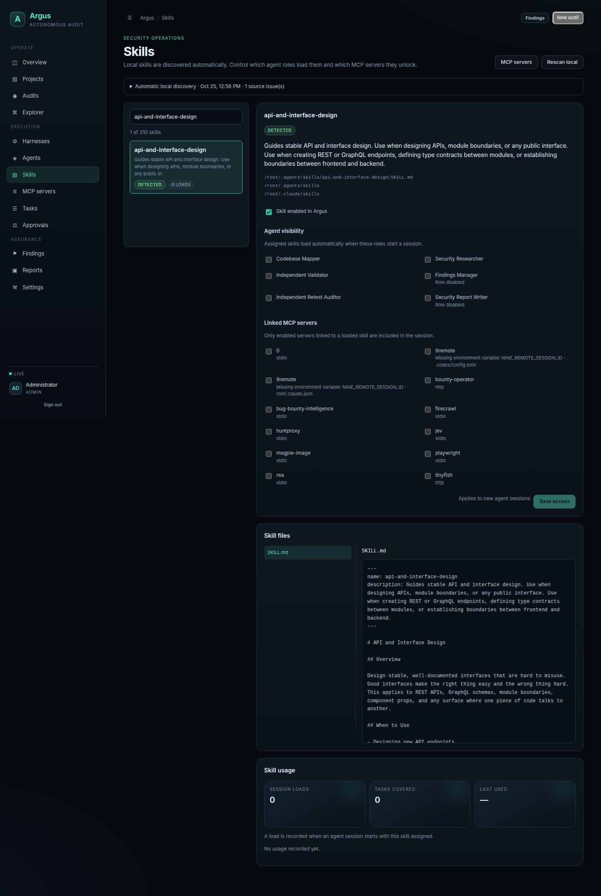
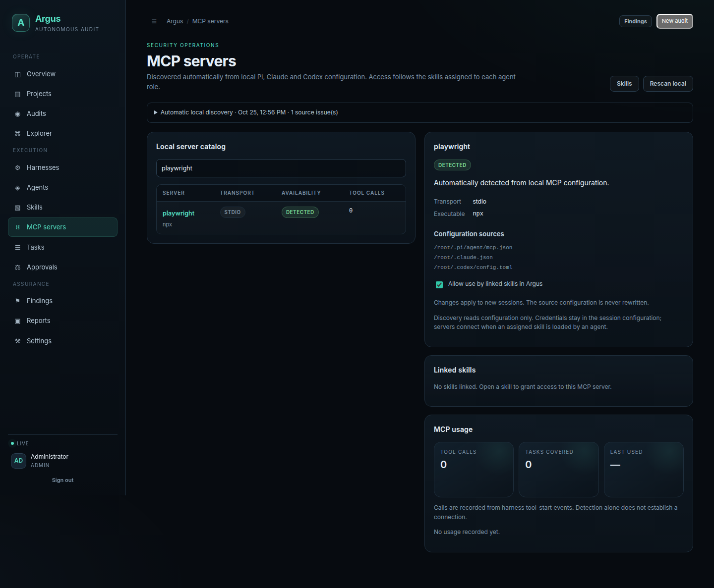

# Argus

**Source code security audits. Evidence you can inspect.**

Argus is a self-hosted workspace for security audits with Pi and Claude Code.
Map a repository, investigate candidates, confirm them in independent agent
sessions, and export reports with source excerpts and traceable evidence.
Your local Skills and MCP configuration are discovered automatically.

[](https://github.com/ajul8866/argus/releases)
[](https://bun.com/docs/installation)
[](LICENSE)

[Quick start](#quick-start) · [Skills & MCP](#local-skills-and-mcp) · [Documentation](#documentation) · [Contribute](#contributing)



*An example audit of the bundled, deliberately vulnerable invoice portal.
Screenshots show real application screens; results depend on the repository,
scope, models, and configured tools.*

## Why Argus

- **A complete audit workflow.** Mapping, discovery, independent confirmation,
  structured findings, independent reverification, and final reporting.
- **Inspectable findings.** Source quotes are checked against the repository
  snapshot. Evidence is hash-chained; finding and verification history retain
  the responsible session.
- **Your existing tools.** Separate adapters for Pi RPC and Claude Code streams,
  with automatic local Skills and MCP discovery and explicit role access.
- **An operational dashboard.** Follow tasks, agent activity, coverage,
  approvals, budgets, cancellations, and failures as they happen.
- **Portable reports.** Export Markdown, JSON, HTML, and PDF from stored audit
  data. Report generation is deterministic.
- **Self-hosted storage.** Bun, strict TypeScript, SQLite, and a vanilla
  TypeScript dashboard. No external database is required.

Argus **v0.0.2** is the current release. Audit findings need human review;
a completed workflow does not guarantee exhaustive coverage or exploitability.
Model providers process the source excerpts sent to them according to your
chosen harness and provider configuration.

## Quick start

### Install and start with one command

On **Linux, macOS, or Windows through WSL2**, with Git and curl installed:

```bash
curl -fsSL https://raw.githubusercontent.com/ajul8866/argus/main/install.sh | bash
```

The installer resolves the newest release tag, installs a private Bun runtime
if needed, installs locked dependencies, builds the dashboard, and starts Argus
in the foreground. Rerunning it updates an existing installation in place and
preserves `data/` and `app/.env`; `ARGUS_VERSION=v0.0.2` pins a release.
Installing Bun requires `unzip`. No `sudo` is used.

Open **http://127.0.0.1:8787**. Initial administrator credentials are generated
on first start and saved in:

```text
~/.local/share/argus/data/bootstrap-admin.txt
```

Sign in, change the password in **Settings**, and delete that credential file.
Press **Ctrl+C** to stop. To start again:

```bash
bash ~/.local/share/argus/start.sh
```

The default install directory follows `XDG_DATA_HOME` when set. Data lives
outside the application checkout, so rerunning the installer updates the app
without touching it. For custom paths, ports, install-only mode, or a
download-first workflow, see [installation details](docs/INSTALLATION.md).

### Configure your agents

The dashboard starts without model credentials. Real audits need **Pi or
Claude Code** installed and a configured provider. The default mixed audit
configuration uses both. These tools and provider usage are managed separately
from the application installer.

1. Open **Harnesses** and check which runtimes Argus detects.
2. Configure provider credentials in **Settings**, or use the supported harness
   environment configuration. See [harness setup](docs/HARNESSES.md).
3. Choose the harness and model for each enabled role in **Agents**.
4. Review automatically detected **Skills** and **MCP servers**. Assign skill
   access to the roles that need it.
5. Add an authorized repository in **Projects**, import its snapshot, and start
   an audit. Review **Findings** and export a **Report** when it finishes.

Harness connection tests and audits make real provider requests and can incur
charges. The [local demo guide](docs/DEMO.md) explains the included test fixture.

### Run from source

With [Bun](https://bun.com/docs/installation) **1.3.14+** and Git:

```bash
git clone https://github.com/ajul8866/argus.git
cd argus
git checkout v0.0.2
bun install --frozen-lockfile --ignore-scripts
bun run build
bun run start
```

For Docker, use the [deployment guide](deploy/README.md). For development,
use `bun run dev` and read [CONTRIBUTING.md](CONTRIBUTING.md).

## Local Skills and MCP

Argus reads supported local configuration on the **machine running the
server**. You do not need to upload a skill archive or manually add an MCP
definition in the dashboard.

| Resource | Automatically discovered sources |
| --- | --- |
| Skills | `~/.agents/skills`, `~/.codex/skills`, cached Codex plugins, `~/.claude/skills`, `~/.pi/agent/skills`, OpenCode skill directories, and supported project-local equivalents |
| MCP | Pi and Claude JSON configuration, Claude Desktop configuration, Codex TOML, and supported project-local MCP files |

Read skill files, assign agent roles, and link the discovered MCP servers from
one place. Missing files, invalid configuration, and unavailable environment
variables remain visible. Skills start with **no role grants**. Only enabled
servers linked to a loaded skill are included in that agent's session.

Detection reports configuration presence. Tool call counts come from observed
harness events. Read [local discovery](docs/LOCAL_RESOURCES.md) for the exact
paths, supported transports, refresh behavior, and limitations.

<details>
<summary><strong>Screenshot — Skills, role access, and local file previews</strong></summary>



</details>

<details>
<summary><strong>Screenshot — MCP catalog, configuration sources, and usage</strong></summary>



</details>

## How an audit works

```text
Repository snapshot
  → Map codebase
  → Investigate scoped areas
  → Confirm candidates in independent sessions
  → Create structured findings
  → Reverify in new sessions
  → Generate reports with evidence and coverage limits
```

The orchestrator controls task dependencies, retries, budgets, permissions,
evidence acceptance, and report contents. A discovery session cannot validate
its own candidate. Model output is schema-validated, and confirmed claims need
matching source evidence. Failed tasks and inconclusive results remain in the
audit history.

Default audit tools are read-only. Bubblewrap can enforce process isolation
on supported Linux hosts; workspace-copy mode has a weaker boundary.
Selected MCP servers have their own capabilities and permissions. Read the
[security model](docs/SECURITY.md) before auditing sensitive repositories or
exposing the dashboard through a reverse proxy.

## Documentation

| Guide | What it covers |
| --- | --- |
| [Installation](docs/INSTALLATION.md) | One-command setup, ports, paths, restart, and troubleshooting |
| [Harnesses](docs/HARNESSES.md) | Pi, Claude Code, credentials, permissions, and runtime protocols |
| [Skills & MCP](docs/LOCAL_RESOURCES.md) | Automatic discovery, role grants, linked servers, and usage |
| [Architecture](docs/ARCHITECTURE.md) | Audit phases, evidence handling, recovery, and reports |
| [API](docs/API.md) | Authentication, endpoints, and event streaming |
| [Deployment](deploy/README.md) | Docker, persistence, and operational configuration |
| [Security](docs/SECURITY.md) | Trust boundaries, isolation, and known limitations |
| [Changelog](CHANGELOG.md) | Release notes |

## Contributing

Contributors are welcome. Help improve installers, harness integrations,
local configuration support, test coverage, accessibility, and documentation.
Small fixes and reproducible bug reports are useful starting points.

Read [CONTRIBUTING.md](CONTRIBUTING.md), browse
[issues](https://github.com/ajul8866/argus/issues), or open a focused pull request.
Report vulnerabilities through the [security policy](SECURITY.md).

## License

Copyright © 2026 ajultect and Argus contributors.
Released under the [GNU Affero General Public License v3.0 only](LICENSE)
(`AGPL-3.0-only`). External harnesses and model providers have their own terms.
