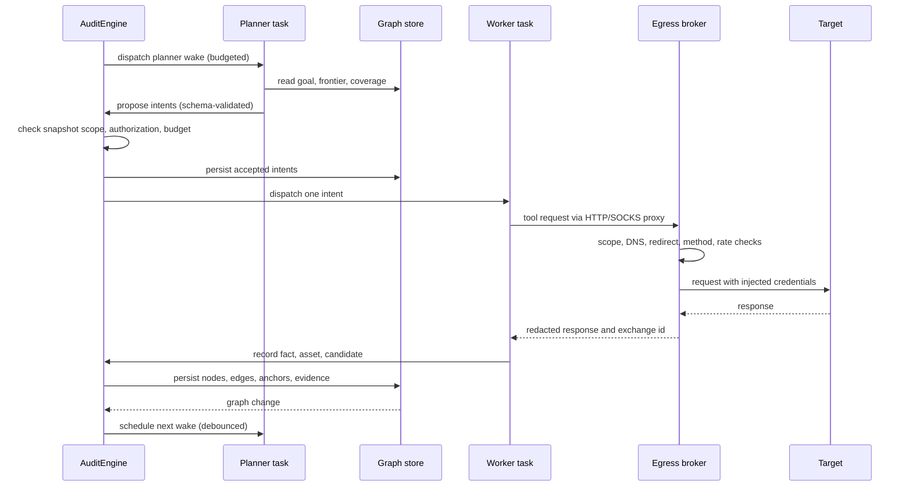

# Argus Dynamic Layer — Design

Status: approved
Date: 2026-10-27
Scope: v1
Repo: `/root/lala` (Argus v0.0.2)

## 1. Intent

Argus today audits source code. A repository is imported as an immutable snapshot, six phases run, and findings are confirmed in independent agent sessions. The default tool policy is read-only and the target code is never executed.

This design adds a dynamic layer. A planner reads the current state, proposes intents, and workers execute real requests against an authorized target. Results are written to two graphs: an asset graph that describes the target, and an exploration graph that records what has been tested and what it produced. Coverage per asset drives the next direction. Findings keep a lineage from goal to intent to fact to finding. Static source quotes and dynamic proof share one evidence chain.

The purpose is not to bolt a scanner onto the side. A dynamic finding must pass the same confirmation and evidence gates as a static finding. Otherwise Argus only adds a new source of false positives.

## 2. Goals, non-goals, anti-goals

### Goals

- Run a dynamic exploration loop under the control of `AuditEngine`.
- Store assets, exploration lineage, and coverage as durable data.
- Produce reproducible dynamic evidence: HTTP exchanges, PoC scripts, PoC runs, environment manifests.
- Confirm dynamic findings with both an exploit check and controls.
- Support retest with strict verdicts and immutable history.
- Expose a read/write agent adapter with per-capability permissions.
- Keep every dynamic request inside the scope and authorization frozen at audit start.
- Let the planner choose its own hypotheses, subgoals, and directions, and propose when a goal is proven. The engine enforces boundaries; it does not prescribe a vulnerability taxonomy.

### Non-goals for v1

- Building and running a target app from its source inside Argus.
- Browser automation in v1. The broker still terminates TLS for HTTP(S) enforcement and recording.
- A third LLM runtime. Planner and workers use the installed Pi or Claude Code harness.
- PostgreSQL or any new external service.
- Automatic fix pull requests.
- A fixed vulnerability-class playbook. The planner chooses its own hypotheses; the engine does not gate exploration by category.

### Anti-goals

- A worker expands its own scope, methods, target, or budget.
- A write grant implicitly authorizes dynamic exploration.
- A finding is marked confirmed without a reproducible run.
- A secret reaches a prompt, transcript, log, evidence file, or report.
- A retest reports `fixed` when the target was down or credentials were expired.
- Coverage looks complete while the target was never actually tested.
- A harness dispatches work or changes the audit plan outside `AuditEngine`.

## 3. Decisions already fixed

| Area | Decision | Source |
|---|---|---|
| Target | A live URL or endpoint declared as authorized, optionally paired with a repository snapshot. Running the app from source is out of v1. | User, round 1 |
| Repository | `static` and `hybrid` require a repository. `dynamic` may run without one. `audits.repository_id` becomes nullable by migration; phase 1, the evidence gate, and the report adapt. | My call, implementing the round-1 optional decision |
| Phase placement | Dynamic work is a task kind `explore` inside phase 2. Phases 3–6 are unchanged. | User, round 1 |
| Graphs | New tables for the asset graph and the exploration graph. Asset coverage is derived from anchors. | User, round 1 |
| Execution | Pi and Claude Code, with a new dynamic profile. No third runtime. Dynamic workers run in a per-audit container with a full toolkit. | User, round 1; tool surface corrected after feedback |
| Tool surface | No per-tool API whitelist. The worker can use the container's shell, scanners, and scripts. The broker is the only egress. | User correction |
| Evidence | Request/response, PoC script, and environment manifest join the SHA-256 evidence chain. | User, round 1 |
| Authorization | A per-project authorization record enforced at egress, not in the prompt. | User, round 1 |
| Mode | Stored in `audits.config`: `static`, `dynamic`, or `hybrid`. Default `static`. | User, round 2 |
| Snapshot | Mode, target, scope, permissions, and budget are frozen at audit start. Every dynamic request is checked against the snapshot. | User, round 2 |
| First proof | Horizontal IDOR on the fixture, as a test of the loop. It is not a boundary on what the planner may explore, and no vulnerability-class roadmap gates later work. | User, round 2 and correction |
| Source quotes | Required only when a relevant source location exists. A dynamic-only finding may be confirmed from reproducible request/response evidence. | User, round 2 |
| PoC | Must include a negative check, not only one successful response. | User, round 2 |
| Target model | Split `project_targets`, `target_authorizations`, and `test_identities`. | User, round 2 |
| Egress limits | Block out-of-scope redirects, disallowed DNS answers, risky methods, and rate-limit violations. | User, round 2 |
| Credentials | Secrets never enter prompts or logs. The agent receives authentication results through a controlled broker. | User, round 2 |
| UI | Three screens. Graph visualization is not a prerequisite; the backend stores nodes and edges from day one and the UI starts as a drillable list. | User, round 2 |
| Retest | Separate `retests` table. `fixed` requires the old PoC to fail while a positive control passes. | User, round 2 |
| Adapter | Read/write from v1. Permissions are separate: `task:create`, `task:control`, `audit:launch_static`, `audit:launch_dynamic`. | User, round 2 |
| Loop authority | `AuditEngine` is the sole authority for lifecycle, scope, budget, and dispatch. Harnesses execute; they do not control. | User, round 2 |
| Autonomy | The planner chooses hypotheses, subgoals, and completion proposals. The engine enforces scope, policy, budget, and evidence only. | User, correction |
| Storage | SQLite WAL. No Postgres. | My call |
| Traffic path | Target traffic goes through Argus's egress broker. The worker has no direct route. | My call, revised after feedback |
| Retest storage | Separate `retests` table, so the `verifications.verdict` CHECK constraint is not rebuilt. | My call |
| Redaction | Applied before storage, using the existing redaction module extended for HTTP headers and bodies. | My call |

## 4. Architecture

### 4.1 Control plane

`AuditEngine` owns:

- audit lifecycle and phase transitions;
- the scope snapshot;
- budget and concurrency;
- intent validation and dispatch;
- graph and evidence writes;
- stop conditions and recovery.

The planner and workers are task roles executed through `HarnessAdapter`. They read state and propose work. They cannot enqueue tasks, change the scope, raise the budget, or approve an action. A planner output is a proposal. `AuditEngine` validates it against the snapshot and either persists it as an intent or rejects it with a reason.

This rule applies to every trigger: the dashboard, an API token, Claude Code, Codex, or Pi. There is no privileged path around the engine.

### 4.1.1 Autonomy contract

The planner controls the research:

- hypotheses, subgoals, and hints;
- the order and grouping of intents;
- which assets to probe and which signals matter;
- which tools and scripts to use inside the worker container;
- when a goal is proven, subject to evidence;
- replanning after facts, failures, and surprises.

The engine controls only the boundaries:

- the authorized target and scope;
- allowed actions and risk policy;
- budgets and concurrency;
- dispatch, retries, and stop conditions;
- evidence acceptance and confirmation independence.

The engine does not prescribe a vulnerability taxonomy, a fixed attack sequence, or a fixed set of test classes. A planner proposal is rejected only for a boundary violation, a duplicate, a budget limit, an expired authorization, or a malformed schema. Everything else is the planner's call.

### 4.2 Components

| Component | Responsibility | Location |
|---|---|---|
| `AuditEngine` | Lifecycle, intent validation, dispatch, stop conditions | `src/orchestrator/engine.ts` (extend) |
| `HarnessManager` | Build adapters and assign the dynamic profile per role | `src/harness/manager.ts` (extend) |
| `TargetService` | Target, authorization, identity CRUD and snapshot validation | `src/dynamic/targets.ts` (new) |
| `EgressBroker` | Scope checks, DNS pinning, redirect policy, method policy, rate limit, recording | `src/dynamic/egress.ts` (new) |
| `CredentialBroker` | Resolve identity, inject credentials at egress, never expose them | `src/dynamic/credentials.ts` (new) |
| `ContainerRuntime` | Per-audit internal network, worker container, broker container, CA lifecycle | `src/dynamic/runtime.ts` (new) |
| `GraphStore` | Asset and exploration graphs, anchors, coverage queries | `src/dynamic/graph.ts` (new) |
| `PoCRunner` | Execute a PoC with positive and negative checks | `src/dynamic/poc.ts` (new) |
| `RetestService` | Retest execution, verdict rules, history | `src/dynamic/retest.ts` (new) |
| `TokenService` | API tokens, scopes, TTL, revocation | `src/auth/tokens.ts` (new) |
| Dynamic UI | Target & coverage, exploration list, finding evidence | `web/` (extend) |

### 4.3 Control flow



The graph change is a scheduling signal, not a dispatch. `AuditEngine` decides whether a new planner wake is allowed under the budget.

### 4.4 Execution profiles

| Role | Runtime | Workspace | Tools | Network |
|---|---|---|---|---|
| Static mapper / researcher / validator | bwrap | Read-only repo | Read-only file tools | None |
| Dynamic planner | container | Read-only repo + scratch | Full toolkit | Broker only |
| Dynamic worker | container | Read-only repo + writable scratch | Full toolkit | Broker only |
| Dynamic validator | container | Read-only repo + scratch | Full toolkit | Broker only |
| Retester | container | Read-only repo + scratch | Full toolkit | Broker only |

The worker gets a full shell and toolkit: bash, curl, Python, node, scanners, and any script it writes. It can install tools from an allowlisted registry when the policy permits. There is no per-tool API whitelist.

The boundary is the network, not the tool list. The worker container is attached only to an internal network whose gateway is the broker. It has no external route. HTTP, HTTPS, and SOCKS traffic go through the broker. The broker enforces target scope, methods, paths, rate, and approval, injects credentials, records exchanges, and redacts secrets. A direct connection attempt has nowhere to go.

This replaces the earlier controlled-tool surface. It costs a Docker or Podman dependency and a container image to maintain. It gives the planner the same freedom as a human operator inside the authorized target.

### 4.5 Sandbox and network

Dynamic mode requires Docker or Podman. If neither is available, a dynamic or hybrid audit refuses to start. Static audits keep the current bwrap and workspace-copy behavior.

Per audit, Argus creates:

- an internal Docker network with no external route;
- a worker container on that network only;
- a broker container on that network and on an egress network.

The worker container:

- runs as a non-root user;
- drops all capabilities except `NET_RAW` when the policy enables raw scanners;
- has a read-only root filesystem with tmpfs for `/tmp` and `/run`;
- mounts the repository snapshot read-only and a scratch workspace read-write;
- mounts no host home, no Argus data, no evidence directory, and no Docker socket;
- uses the default seccomp profile with no privileged mode;
- receives `HTTP_PROXY`, `HTTPS_PROXY`, and `ALL_PROXY` pointing at the broker;
- trusts only the per-audit MITM CA.

The broker container holds the external route, the credential store, and the recording layer. It terminates TLS for HTTP, enforces method and path policy, proxies SOCKS5 for non-HTTP TCP to declared host/port pairs, and logs every decision. Provider traffic also goes through the broker: the worker gets a placeholder provider key and a broker base URL; the broker swaps in the real key for allowlisted provider hosts.

## 5. Data model

All tables use SQLite. New tables are added by a numbered migration. Existing tables are altered only by adding nullable columns or new rows, except where noted.

### 5.1 Audit snapshot

```sql
CREATE TABLE audit_scope_snapshots (
  audit_id TEXT PRIMARY KEY REFERENCES audits(id) ON DELETE CASCADE,
  created_at TEXT NOT NULL,
  snapshot TEXT NOT NULL,
  sha256 TEXT NOT NULL
);
CREATE TRIGGER audit_scope_snapshots_no_update
BEFORE UPDATE ON audit_scope_snapshots
BEGIN SELECT RAISE(ABORT, 'audit scope snapshot is immutable'); END;
CREATE TRIGGER audit_scope_snapshots_no_delete
BEFORE DELETE ON audit_scope_snapshots
BEGIN SELECT RAISE(ABORT, 'audit scope snapshot is immutable'); END;
```

`snapshot` holds:

```json
{
  "mode": "hybrid",
  "target": {
    "id": "...",
    "base_url": "https://app.example.test",
    "allowed_hosts": ["app.example.test"],
    "allowed_cidrs": ["203.0.113.0/24"],
    "allowed_methods": ["GET", "POST"],
    "max_rps": 5,
    "tls": true
  },
  "authorization": {
    "id": "...",
    "authorized_by": "...",
    "reference": "...",
    "valid_from": "2026-10-27T00:00:00Z",
    "valid_until": "2026-11-03T00:00:00Z",
    "authorized_actions": {
      "methods": ["GET", "POST"],
      "allow_state_changing": false,
      "allow_file_upload": false,
      "allow_bruteforce": false,
      "require_approval_for": ["POST", "PUT", "PATCH", "DELETE"]
    },
    "restrictions": {
      "allowed_paths": [],
      "denied_paths": [],
      "notes": "staging only; no destructive tests"
    }
  },
  "identities": [
    { "id": "...", "role": "user_a" },
    { "id": "...", "role": "user_b" }
  ],
  "permissions": ["task:create", "task:control", "audit:launch_dynamic"],
  "budget": {
    "max_usd": 20,
    "exploration_cap_usd": 12,
    "verification_reserve_usd": 8,
    "max_tasks": 200,
    "max_requests": 5000,
    "max_runtime_minutes": 240
  },
  "repository": { "id": "...", "commit_sha": "..." },
  "created_by": "user-id",
  "created_at": "2026-10-27T12:00:00Z"
}
```

`repository` is `null` for a dynamic-only audit. `sha256` covers the canonical JSON. The broker reads this row, not the live target tables, while the audit is running.

### 5.2 Targets, authorizations, identities

```sql
CREATE TABLE project_targets (
  id TEXT PRIMARY KEY,
  project_id TEXT NOT NULL REFERENCES projects(id) ON DELETE CASCADE,
  label TEXT NOT NULL,
  base_url TEXT NOT NULL,
  environment TEXT NOT NULL,
  repository_id TEXT REFERENCES repositories(id),
  allowed_hosts TEXT NOT NULL,
  allowed_cidrs TEXT NOT NULL,
  allowed_methods TEXT NOT NULL,
  max_rps REAL NOT NULL DEFAULT 5,
  tls_required INTEGER NOT NULL DEFAULT 1 CHECK (tls_required IN (0,1)),
  status TEXT NOT NULL DEFAULT 'active' CHECK (status IN ('active','disabled')),
  created_by TEXT REFERENCES users(id),
  created_at TEXT NOT NULL,
  updated_at TEXT NOT NULL
);

CREATE TABLE target_authorizations (
  id TEXT PRIMARY KEY,
  target_id TEXT NOT NULL REFERENCES project_targets(id) ON DELETE CASCADE,
  authorized_by TEXT NOT NULL,
  authorization_ref TEXT NOT NULL,
  valid_from TEXT NOT NULL,
  valid_until TEXT NOT NULL,
  authorized_actions TEXT NOT NULL,
  restrictions TEXT NOT NULL,
  status TEXT NOT NULL DEFAULT 'active' CHECK (status IN ('active','expired','revoked')),
  created_by TEXT REFERENCES users(id),
  created_at TEXT NOT NULL
);

CREATE TABLE test_identities (
  id TEXT PRIMARY KEY,
  target_id TEXT NOT NULL REFERENCES project_targets(id) ON DELETE CASCADE,
  label TEXT NOT NULL,
  role TEXT NOT NULL,
  auth_kind TEXT NOT NULL CHECK (auth_kind IN ('none','header','cookie','basic')),
  secret_ref TEXT,
  status TEXT NOT NULL DEFAULT 'active' CHECK (status IN ('active','expired','disabled')),
  created_at TEXT NOT NULL,
  updated_at TEXT NOT NULL
);
```

`secret_ref` points at `provider_credentials` or a new encrypted secret store. It is never returned by the API.

`authorized_actions` and `restrictions` are structured JSON, not a vulnerability-class whitelist. `authorized_actions` covers methods, state changes, uploads, brute force, and approval requirements. `restrictions` covers allowed and denied paths plus advisory notes. The planner may pursue any hypothesis inside the authorized target. The engine checks the request's host, CIDR, method, path, rate, and risk policy; it does not check a category label. `category` on a finding is a free-form reporting label and never a dispatch gate.

### 5.3 Graphs

```sql
CREATE TABLE assets (
  id TEXT PRIMARY KEY,
  project_id TEXT NOT NULL REFERENCES projects(id) ON DELETE CASCADE,
  kind TEXT NOT NULL CHECK (kind IN ('root_domain','subdomain','ip','service','app','endpoint')),
  asset_key TEXT NOT NULL,
  parent_id TEXT REFERENCES assets(id),
  data TEXT NOT NULL,
  first_seen_at TEXT NOT NULL,
  last_seen_at TEXT NOT NULL,
  UNIQUE (project_id, kind, asset_key)
);

CREATE TABLE asset_edges (
  from_asset_id TEXT NOT NULL REFERENCES assets(id) ON DELETE CASCADE,
  to_asset_id TEXT NOT NULL REFERENCES assets(id) ON DELETE CASCADE,
  kind TEXT NOT NULL,
  PRIMARY KEY (from_asset_id, to_asset_id, kind)
);

CREATE TABLE exploration_nodes (
  id TEXT PRIMARY KEY,
  audit_id TEXT NOT NULL REFERENCES audits(id) ON DELETE CASCADE,
  kind TEXT NOT NULL CHECK (kind IN ('goal','intent','fact','finding','hint')),
  status TEXT NOT NULL CHECK (status IN ('proposed','approved','claimed','running','completed','failed','rejected')),
  task_id TEXT REFERENCES tasks(id),
  session_id TEXT REFERENCES agent_sessions(id),
  payload TEXT NOT NULL,
  retry_count INTEGER NOT NULL DEFAULT 0,
  created_at TEXT NOT NULL,
  updated_at TEXT NOT NULL
);

CREATE TABLE exploration_edges (
  from_node_id TEXT NOT NULL REFERENCES exploration_nodes(id) ON DELETE CASCADE,
  to_node_id TEXT NOT NULL REFERENCES exploration_nodes(id) ON DELETE CASCADE,
  kind TEXT NOT NULL CHECK (kind IN ('spawns','derived_from','yields','proves','rejects')),
  PRIMARY KEY (from_node_id, to_node_id, kind)
);

CREATE TABLE anchors (
  node_id TEXT NOT NULL REFERENCES exploration_nodes(id) ON DELETE CASCADE,
  asset_id TEXT NOT NULL REFERENCES assets(id) ON DELETE CASCADE,
  PRIMARY KEY (node_id, asset_id)
);

CREATE INDEX idx_assets_project ON assets(project_id);
CREATE INDEX idx_exploration_audit ON exploration_nodes(audit_id, status);
CREATE INDEX idx_anchors_asset ON anchors(asset_id);
```

Coverage is a query, not a mutable counter:

```sql
-- tested assets for an audit
SELECT DISTINCT a.id, a.kind, a.asset_key
FROM assets a
JOIN anchors an ON an.asset_id = a.id
JOIN exploration_nodes n ON n.id = an.node_id
WHERE n.audit_id = ? AND n.kind IN ('intent','fact','finding')
  AND n.status IN ('completed','running');
```

A materialized `asset_coverage` table can be added later if the query is slow. v1 uses the query.

### 5.4 Dynamic evidence

```sql
ALTER TABLE findings ADD COLUMN provenance TEXT NOT NULL DEFAULT 'static';
-- allowed values are enforced in code: static, dynamic, hybrid

CREATE TABLE http_exchanges (
  id TEXT PRIMARY KEY,
  audit_id TEXT NOT NULL REFERENCES audits(id) ON DELETE CASCADE,
  task_id TEXT REFERENCES tasks(id),
  session_id TEXT REFERENCES agent_sessions(id),
  identity_id TEXT REFERENCES test_identities(id),
  method TEXT NOT NULL,
  url TEXT NOT NULL,
  request_headers TEXT NOT NULL,
  response_status INTEGER,
  response_headers TEXT,
  request_evidence_id TEXT REFERENCES evidence(id),
  response_evidence_id TEXT REFERENCES evidence(id),
  duration_ms INTEGER,
  scope_decision TEXT NOT NULL,
  created_at TEXT NOT NULL
);

CREATE TABLE pocs (
  id TEXT PRIMARY KEY,
  audit_id TEXT NOT NULL REFERENCES audits(id) ON DELETE CASCADE,
  candidate_id TEXT REFERENCES candidates(id),
  finding_id TEXT REFERENCES findings(id),
  language TEXT NOT NULL,
  script_evidence_id TEXT NOT NULL REFERENCES evidence(id),
  positive_check TEXT NOT NULL,
  negative_check TEXT NOT NULL,
  environment_manifest TEXT NOT NULL,
  created_at TEXT NOT NULL
);

CREATE TABLE poc_runs (
  id TEXT PRIMARY KEY,
  poc_id TEXT NOT NULL REFERENCES pocs(id) ON DELETE CASCADE,
  audit_id TEXT NOT NULL REFERENCES audits(id) ON DELETE CASCADE,
  session_id TEXT REFERENCES agent_sessions(id),
  status TEXT NOT NULL CHECK (status IN ('passed','failed','error')),
  positive_passed INTEGER NOT NULL CHECK (positive_passed IN (0,1)),
  negative_passed INTEGER NOT NULL CHECK (negative_passed IN (0,1)),
  exploit_passed INTEGER NOT NULL CHECK (exploit_passed IN (0,1)),
  output_evidence_id TEXT REFERENCES evidence(id),
  started_at TEXT NOT NULL,
  ended_at TEXT
);

CREATE TABLE retests (
  id TEXT PRIMARY KEY,
  finding_id TEXT NOT NULL REFERENCES findings(id) ON DELETE CASCADE,
  audit_id TEXT NOT NULL REFERENCES audits(id) ON DELETE CASCADE,
  requested_by TEXT REFERENCES users(id),
  reason TEXT NOT NULL,
  fix_reference TEXT,
  authorization_snapshot TEXT NOT NULL,
  environment_manifest TEXT NOT NULL,
  commit_sha TEXT,
  build_ref TEXT,
  environment_match INTEGER CHECK (environment_match IN (0,1)),
  executed_by TEXT,
  positive_check TEXT,
  status TEXT NOT NULL CHECK (status IN ('queued','running','completed','failed')),
  verdict TEXT CHECK (verdict IN ('still_reproducible','fixed','cannot_confirm')),
  evidence_refs TEXT,
  started_at TEXT,
  ended_at TEXT,
  created_at TEXT NOT NULL
);
```

The `retests` row is created with `status = 'queued'` and no verdict. `executed_by`, `positive_check`, `evidence_refs`, and `started_at` are filled when execution starts. `verdict` is set only when `status = 'completed'`. A failed execution keeps the original verdict `NULL` and records the failure reason in `evidence_refs` or a dedicated `error` column added at implementation time.

The `candidates` table changes by rebuild: `area_id` becomes nullable, and two columns are added: `provenance` (`static`, `dynamic`, `hybrid`) and `link_key` (nullable). A dynamic candidate without a static area stores `area_id = NULL`. The rebuild is required because SQLite cannot drop a `NOT NULL` constraint.

Existing `findings.files` and `findings.root_cause` stay `NOT NULL`. A dynamic-only finding stores `files = '[]'` and a root cause sentence that says the source location was not identified. The report renders that explicitly. No table rebuild.

### 5.5 API tokens

```sql
CREATE TABLE api_tokens (
  id TEXT PRIMARY KEY,
  user_id TEXT NOT NULL REFERENCES users(id) ON DELETE CASCADE,
  label TEXT NOT NULL,
  token_hash TEXT NOT NULL UNIQUE,
  scopes TEXT NOT NULL,
  project_id TEXT REFERENCES projects(id) ON DELETE CASCADE,
  audit_id TEXT REFERENCES audits(id) ON DELETE CASCADE,
  expires_at TEXT,
  revoked_at TEXT,
  last_used_at TEXT,
  created_at TEXT NOT NULL
);
CREATE INDEX idx_api_tokens_user ON api_tokens(user_id);
```

Scopes are stored as a JSON array. Token values are shown once at creation and stored as SHA-256 hashes.

### 5.6 Audit state additions

`audits` gains `stop_reason TEXT`, `mode TEXT`, and `exploration_status TEXT` (`not_applicable`, `open`, `closing`, `closed`), all nullable. `repository_id` becomes nullable by table rebuild: `static` and `hybrid` audits still require it, `dynamic` audits may omit it. `audits.config` keeps the full creation payload for compatibility.

## 6. Audit flow

### 6.1 Create

`POST /api/audits` accepts `mode`, `target_id`, `budget`, and the existing overrides. `mode` defaults to `static`. A `dynamic` or `hybrid` audit requires a target with an active authorization and at least two active identities for IDOR work.

### 6.2 Start

`startAudit` performs these checks before any task is queued:

1. The project is authorized. `static` and `hybrid` require a repository; `dynamic` may omit it.
2. The target belongs to the project and is `active`.
3. The authorization is `active`, not revoked, and covers the current time.
4. The authorized actions cover the requested mode.
5. The budget is within the configured maximum.
6. Docker or Podman is available for dynamic or hybrid.
7. At least one identity is configured; the first IDOR proof requires two.

It then writes `audit_scope_snapshots`, sets `audits.mode`, and seeds the exploration graph with one `goal` node. The goal payload names the target, the authorized actions, and the stop conditions. Phase 1 runs for `static` and `hybrid`. A `dynamic` audit without a repository skips phase 1, seeds the base `app` asset from the target, and marks phase 1 `skipped`. The report omits source architecture and says so. The evidence gate runs in no-repository mode: no quote can be required, and dynamic evidence is mandatory.

Any failed check refuses the start with a machine-readable reason and writes an `audit_log` entry.

### 6.3 Planner

The planner wakes when:

- the audit starts and the goal is written;
- a worker completes or fails;
- a graph fact changes;
- a debounce timer expires;
- an operator requests a replan.

`AuditEngine` coalesces wakes. It dispatches a planner task only if the budget allows and the frontier is not already saturated.

Planner input:

- goal node;
- current frontier: intents with `proposed` or `approved` status;
- recent facts and findings;
- coverage summary;
- remaining budget and time;
- the snapshot scope (hosts, methods, restrictions).

Planner output: zero or more intents. Each intent has an id, a title, the target asset ids, the proposed method and path, the expected signal, and a rationale. The schema is validated. The intent has no vulnerability-class field. A free-form `category` may be carried for reporting; the engine never accepts or rejects an intent because of it. `AuditEngine` then checks:

- the asset is in the project;
- the method is allowed;
- the URL stays inside the snapshot host/CIDR rules;
- the intent is not a duplicate of a completed or running intent;
- the authorization is still valid;
- the budget allows another task.

Accepted intents become `exploration_nodes` with `kind = 'intent'` and `status = 'approved'`. The intent lifecycle is `proposed` → `approved` → `claimed` → `running` → `completed` or `failed`. Invalid intents are `rejected` and stored with a reason, so the planner does not loop on them. A failed intent may be retried once. The retry is a new task with `retry_count` incremented and a `derived_from` edge to the failed intent. After that the intent stays `failed` and a fact records why.

Phase 2 stays open while `audits.exploration_status = 'open'`. The phase-2 barrier requires both: every static `discover` task terminal (for `static` and `hybrid`), and exploration `closed`. Exploration closes when the goal is proven, the exploration cap is reached, the authorization expires, or the operator stops it. `AuditEngine` is the only writer of `exploration_status`.

Coverage uses exchanges, not intent status. An asset counts as tested only when it has at least one allowed `http_exchange` with a recorded response, anchored through a completed intent or fact. An intent that made no request does not count.

The planner may create subgoals and hints. Each is a node with a `spawns` edge from a parent goal or intent. The engine validates the node against the snapshot but does not require a category. The planner proposes `prove_goal` with a rationale. The engine accepts when either every in-scope asset for the goal has been tested or explicitly marked `not_applicable`, or the planner records why the remaining assets are unreachable and a fact supports it. No intent may still be `approved`, `claimed`, or `running`.

Budget has two pools from the snapshot: `exploration_cap_usd` for planner and worker exploration, and `verification_reserve_usd` for phases 3–6, confirmation, PoC runs, and retests. The conventional split is 60/40 and is configurable per audit. `max_requests` counts every broker request, including validation, retest, cleanup, and redirects. When the exploration cap is reached, exploration closes; verification continues on the reserve. When the overall budget is exhausted, the engine stops dispatch and records `stop_reason`.

### 6.4 Worker

`AuditEngine` claims one approved intent with a conditional update, creates an `explore` task in phase 2, and dispatches a harness session with the worker profile.

The worker receives:

- the intent payload;
- the asset context;
- identity ids, never secrets;
- the scope and method rules;
- the remaining request budget.

It records observations through the engine's graph API. Each write is schema-validated, attributed to the task and session, and appended as evidence where relevant. A worker cannot confirm its own candidate.

### 6.5 Confirmation and findings

A worker proposes a candidate: title, category, severity, affected asset, evidence ids, and a PoC manifest. `AuditEngine` creates a `candidates` row with provenance.

Phase 3 creates a fresh session that did not discover the candidate. For a dynamic candidate, the validator:

1. runs the positive control;
2. runs the exploit check;
3. runs the negative control;
4. inspects the recorded exchanges;
5. verifies the source quote if one is provided.

A dynamic candidate is `CONFIRMED` only if the exploit check passes, the positive control passes, and the negative control passes. A missing source quote does not downgrade it. If a quote is provided, `evidence-gate.ts` verifies it against the snapshot; a failed quote does downgrade the finding, because the claim about the source is then false.

Phase 4 is deterministic. It writes the finding with `provenance`, allows an empty `files` array, and records a root-cause sentence that states whether the source location was identified.

Hybrid merge is explicit. `candidates` gains `provenance` and `link_key`. A dynamic candidate's `link_key` is the normalized handler path derived from the asset and the intent's `source_hint`. A static candidate's `link_key` is its normalized file path plus category. Phase 4 merges two candidates into one finding only when the audit is `hybrid`, the categories match, and the `link_key` values match. Title similarity is never enough. When they merge, the finding receives both evidence sets and `provenance = 'hybrid'`; both candidate rows point to the same `finding_id`. When there is no match, they remain two findings and the report labels the dynamic one separately.

Phase 5 runs the existing reverification. For dynamic findings it re-runs the PoC under the retest rules in section 8.4.

### 6.6 Stop conditions

`AuditEngine` stops dispatching and marks the audit when any of these is true:

- the authorization expires or is revoked;
- a request is blocked for being outside scope;
- the budget (USD, tasks, requests, or runtime) is exhausted;
- the target is unreachable or failing health checks;
- the rate limit is repeatedly hit;
- the operator cancels.

The engine sets `audits.stop_reason`, marks queued tasks `blocked`, and leaves completed evidence untouched. It does not mark the audit complete if coverage was cut short.

### 6.7 Recovery

Intents, tasks, sessions, and evidence are durable rows. On restart:

- running sessions are failed with an interruption reason, as today;
- running tasks are requeued if retry budget remains;
- approved intents are dispatched again under the same snapshot;
- expired authorizations block the audit rather than silently continuing.

## 7. Scope and credential enforcement

### 7.1 Egress checks

The broker checks every request, including redirects:

| Check | Rule |
|---|---|
| Scheme | HTTPS unless the target explicitly allows HTTP for a local environment |
| Host | Must match an `allowed_hosts` entry. Suffix wildcards are accepted only when declared |
| DNS | Resolve A and AAAA. Reject loopback, link-local, multicast, `169.254.169.254`, and private ranges unless the CIDR is declared |
| IP pinning | Connect to the resolved IP, not a second resolution. Re-check every redirect |
| Redirects | Maximum 3. A redirect to a host or scheme outside scope is blocked |
| Method | `GET`, `HEAD`, `OPTIONS` by default. `POST`, `PUT`, `PATCH`, `DELETE` require declaration |
| Risky actions | File upload, bulk state changes, brute force, and destructive methods require an approval gate |
| Rate | Per target and per identity, from the snapshot |
| Size and time | Request and response caps; connect and read timeouts |
| Recording | Metadata and redacted bodies become evidence |

A blocked request is recorded with `scope_decision = 'blocked'` and the reason. A scope block stops the audit under section 6.6.

Transport: the worker reaches the broker over HTTP CONNECT and SOCKS5. The broker terminates TLS with a per-audit CA so it can enforce method and path and record exchanges. Non-HTTP TCP is limited to declared host/port pairs. Direct egress is impossible because the worker network has no external route.

Approval for a risky request happens mid-session. A brokered request that needs approval returns a structured `approval_required` response with an `approval_id` and a hash of the exact method, URL, and body. The engine writes an `approvals` row with the task, session, identity, request hash, and policy reason. The worker waits or polls, bounded by the task timeout. Approval covers that request hash only. A changed body or URL needs a new approval. Denied or timed-out requests are recorded as denied and returned as a broker error. The IDOR slice seeds its test objects before the run; if a cleanup `DELETE` is needed, it goes through the same gate.

### 7.2 Credential broker

- Secrets are encrypted with the existing master-key path.
- The agent references `identity_id`; the broker resolves the secret and injects it at egress.
- The agent receives the response, never the credential.
- Redaction runs before anything is written or logged. Headers `Authorization`, `Cookie`, `Set-Cookie`, `X-Api-Key`, and configured patterns are removed. Bodies are scanned with the existing patterns plus target-specific patterns.
- If redaction fails, the write fails closed. The request is not stored unredacted.
- Rotating or disabling an identity takes effect on the next request.
- Provider keys are injected by the broker too. The worker sees a placeholder key and a broker base URL; the broker swaps in the real key for allowlisted provider hosts.

### 7.3 Prompt injection

Target responses are untrusted. They are stored as evidence and passed to the model only as data. The system prompts state that response content cannot change scope, methods, targets, or budget. Enforcement does not depend on the prompt: the broker, the snapshot, and the engine's validation are the boundaries.

## 8. Evidence, findings, and retest

### 8.1 Evidence kinds

New evidence kinds join the existing chain:

- `http_exchange_request`
- `http_exchange_response`
- `poc_script`
- `poc_run_output`
- `environment_manifest`
- `exploration_fact`

The chain logic, sidecar verification, and append-only triggers are unchanged.

### 8.2 Finding provenance

| Provenance | Required source quote | Required dynamic proof |
|---|---|---|
| `static` | Yes, at least one relevant excerpt | No |
| `hybrid` | Yes, when a source location is claimed | Yes |
| `dynamic` | No | Yes: exploit check, positive control, negative control, environment manifest |

The evidence gate becomes conditional:

- it verifies every quote that is present;
- it requires a quote for `static` and `hybrid` findings that claim a source location;
- it requires a successful `poc_run` for `dynamic` and `hybrid` findings;
- it never downgrades a dynamic finding merely because no quote exists.

### 8.3 PoC contract

A PoC is stored as a script plus a JSON manifest:

```json
{
  "language": "python",
  "script_evidence_id": "ev_...",
  "object": {
    "asset_id": "asset_...",
    "object_id": "invoice_123",
    "owner_identity": "user_b"
  },
  "checks": {
    "positive": {
      "identity": "user_b",
      "request": { "method": "GET", "path": "/invoices/invoice_123" },
      "expect": { "status": 200, "body_contains": "invoice_123" }
    },
    "exploit": {
      "identity": "user_a",
      "request": { "method": "GET", "path": "/invoices/invoice_123" },
      "expect": { "status": 200, "body_contains": "invoice_123" }
    },
    "negative": {
      "identity": "user_a",
      "request": { "method": "GET", "path": "/invoices/invoice_999" },
      "expect": { "status": [403, 404] }
    }
  },
  "cleanup": "delete created records",
  "environment": {
    "target": "https://app.example.test",
    "commit_sha": "...",
    "identities": ["user_a", "user_b"]
  }
}
```

The runner enforces structural relationships, not just status codes:

- the positive and exploit checks use the same asset and the same object id;
- the positive check uses the owner identity, the exploit check uses the attacker identity, and the negative check uses the attacker identity on a distinct object id that must be denied;
- a positive check on a different endpoint, a health endpoint, or a different object is rejected;
- the engine evaluates the declared predicates against the recorded exchange; it does not accept the model's claim that a check passed.

The validator may reject a PoC or write a replacement. A replacement starts a new run, both PoCs are kept, and the finding cites the final run that passed all three checks.

The runner records each check separately. A run is `passed` only when all three checks pass. A run with a failed positive control is `error`, even if the exploit check passed, because the environment is not trustworthy.

### 8.4 Retest

A retest row is created on manual request or when a fix reference is supplied. The retester uses a fresh session.

Verdict rules, in order:

1. Run the positive control. If it fails, the verdict is `cannot_confirm`. A broken environment never produces `fixed`.
2. Run the old PoC exploit check. If it succeeds, the verdict is `still_reproducible`.
3. If the exploit check fails and the positive control passes, the verdict is `fixed`.
4. If the PoC cannot run, the target is down, credentials expired, or the result is ambiguous, the verdict is `cannot_confirm`.

Each retest stores the environment manifest, commit or build reference, start and end time, executor, positive-control result, and evidence ids. Old evidence is never overwritten.

Phase 5 and `retests` coexist. Phase 5 is the audit-final reverification and always writes a `verifications` row. A dynamic finding gets that row and may later get one or more `retests` rows. A retest does not replace phase 5 and does not change the finding's immutable provenance.

A retest requires a currently valid authorization for the target. The original audit's snapshot may be expired; the retest stores its own authorization snapshot and fails closed if no authorization is valid. It may use a new authorization for the same target. A static-only finding may be retested dynamically when the project has a target and the operator supplies a PoC; the retest row records the dynamic evidence, but the finding stays `static`.

`fixed` requires the retest environment to match the original: same target, same environment label, same identity roles, and the same commit or build reference except for the fix under test. If the environment differs, `environment_match = 0` and the verdict is `cannot_confirm` unless the operator explicitly records an equivalent environment.

## 9. Permissions and agent integration

### 9.1 Scopes

| Scope | Allows |
|---|---|
| `audit:read` | Read audits, tasks, coverage, findings |
| `finding:read` | Read findings and evidence |
| `task:create` | Create a task inside an existing audit, subject to the audit mode |
| `task:control` | Pause, resume, cancel a task |
| `audit:launch_static` | Create and start a static audit |
| `audit:launch_dynamic` | Create and start a dynamic or hybrid audit |
| `target:manage` | Create or edit targets, authorizations, identities |

`task:create` does not imply `audit:launch_dynamic`. Creating an `explore` task requires both the dynamic launch scope and an audit already running in dynamic or hybrid mode. The engine re-checks the snapshot on every launch, regardless of the caller.

### 9.2 Token rules

- Token value is shown once; only a hash is stored.
- Tokens are scoped to a project or an audit.
- Tokens have an expiry and can be revoked.
- `last_used_at` is updated per use.
- Every write is recorded in `audit_log` with the token id, actor, scope, action, and target.
- Expired or revoked tokens fail closed.

### 9.3 Adapter contract

The MCP adapter uses the same authenticated REST API as the dashboard. It has no direct database or engine access.

Read tools:

- `health`
- `list_audits`
- `get_audit`
- `get_coverage`
- `list_findings`
- `get_finding`

Write tools:

- `launch_audit` (requires `audit:launch_static` or `audit:launch_dynamic`)
- `create_task` (requires `task:create`; dynamic tasks also require `audit:launch_dynamic`)
- `control_task` (requires `task:control`)

Claude Code, Codex, and Pi use the same adapter. There is no per-harness permission path.

## 10. UI

Three screens are added to the existing dashboard.

### 10.1 Target & coverage

- Project targets with authorization status, valid-until, and environment.
- Asset list with coverage state: untested, tested, tested with findings.
- Filters by kind (`endpoint`, `service`, `app`, ...) and coverage.
- Drill-down from an asset to the intents and findings anchored to it.

Data: `GET /api/projects/:id/targets`, `GET /api/audits/:id/assets?coverage=...`.

### 10.2 Exploration

- A hierarchical list, not a canvas: goal → intents → facts → findings.
- Each row shows status, task, session, and evidence count.
- Clicking a row opens the task, session, or evidence.
- A graph canvas can be added later from the same nodes and edges.

Data: `GET /api/audits/:id/exploration?format=list`, `GET /api/audits/:id/exploration/:nodeId`.

### 10.3 Finding evidence

- Source quotes, when present.
- HTTP exchanges with request and response, redacted.
- PoC script, run history, positive and negative results.
- Retest history and verdicts.
- Provenance label: static, dynamic, or hybrid.

Data: `GET /api/findings/:id` extended with `exchanges`, `pocs`, `poc_runs`, and `retests`.

Live updates use the existing SSE stream. New event types: `exploration.node`, `asset.updated`, `http.exchange`, `poc.run`, `retest.updated`.

## 11. Work plan

The order follows the review: permissions and target model first, then the first slice.

### Stage 0 — Target, authorization, identity, snapshot (priority: item 03)

Deliverables:

- migrations for `project_targets`, `target_authorizations`, `test_identities`, `audit_scope_snapshots`;
- `audits.repository_id` nullable, with the phase-1 skip path and no-repository report mode;
- `TargetService` with validation and snapshot creation;
- CRUD routes (dashboard forms in Stage 5);
- start-audit checks from section 6.2;
- tests for expired, revoked, out-of-scope, and missing-identity cases.

Exit: a dynamic audit cannot start without a valid target, authorization, two identities for IDOR, and Docker or Podman.

### Stage 1 — Permission model and adapter (priority: item 06)

Deliverables:

- `api_tokens` migration and `TokenService`;
- scope checks on every write route;
- `launch_audit`, `create_task`, `control_task` tools;
- `audit_log` entries for token actions;
- tests proving `task:create` alone cannot launch a dynamic audit.

Exit: two tokens with different scopes behave differently through the same API, and every dynamic launch passes the same checks as a dashboard launch.

### Stage 2 — Egress and credential broker

Deliverables:

- worker container image with a full toolkit, pinned by digest;
- per-audit internal network and broker container;
- `EgressBroker` with HTTP CONNECT, SOCKS5, a per-audit MITM CA, host, CIDR, DNS, redirect, method, rate, size, and timeout checks;
- `CredentialBroker` with target and provider secret injection and redaction;
- evidence records for requests, responses, runs, and manifests;
- tests for redirect escape, DNS rebinding, metadata IP, disallowed method, rate limit, and secret leakage.

Exit: a worker can use any tool in the container and still reach only the authorized target through the broker. Redirects, DNS answers, raw TCP, and shell escape do not open another path.

### Stage 3 — Graphs and the loop

Deliverables:

- graph tables and `GraphStore`;
- planner and worker task kinds in phase 2;
- the phase-2 open/close marker (`audits.exploration_status`);
- intent validation, dispatch, debounce, budget, and stop conditions;
- coverage queries and exploration list API;
- recovery tests.

Exit: a scripted planner/worker run produces assets, intents, facts, and coverage; a restart resumes the loop under the same snapshot.

### Stage 4 — First proof of the loop: horizontal IDOR on the fixture (priority: item 02)

Deliverables:

- run the fixture `test/fixtures/vulnerable-app` as an authorized local target with two identities;
- one IDOR candidate from a worker;
- confirmation with positive, exploit, and negative checks;
- finding with `provenance = 'dynamic'` or `'hybrid'`;
- the hybrid merge by `link_key`, when a static candidate matches;
- source quote linked when the handler is identified;
- retest with the strict verdict rules;
- report includes the dynamic evidence.

Exit: the invoice ownership weakness is found, confirmed, persisted, retested, and exported without relying on a source quote. The report labels the missing root cause. This case proves the loop; it does not limit the planner to IDOR.

### Stage 5 — UI and reporting

Deliverables:

- three screens from section 10;
- SSE events;
- report sections for coverage, dynamic evidence, and retest history;
- documentation updates.

Exit: an operator can follow an asset to an intent, a session, an exchange, a PoC, a finding, and a retest in the dashboard.

### Later

- More tools and transports: browser, API spec import.
- Graph canvas.
- Coverage and planner improvements.

There is no fixed vulnerability-class roadmap. The planner explores whatever the authorized target exposes; later work adds tools and coverage, not classes.

## 12. Testing and verification

### Existing suite

Every stage must keep `bun run typecheck` and the existing `bun test` suite green. The command is run before the first edit and again after the last edit of a stage.

### New tests

| File | Covers |
|---|---|
| `test/dynamic-targets.test.ts` | Target, authorization, identity, snapshot immutability |
| `test/egress.test.ts` | Host, CIDR, DNS pinning, redirect, method, rate, redaction |
| `test/permissions.test.ts` | Scope separation, token expiry, revocation, audit log |
| `test/exploration.test.ts` | Planner validation, intent lifecycle, coverage, stop conditions, recovery |
| `test/idor.test.ts` | Positive, exploit, and negative checks; retest verdicts |
| `test/dynamic-e2e.test.ts` | Fixture app, two identities, full audit, report |

### Security tests

- Out-of-scope redirect is blocked.
- A hostname that resolves to a private or metadata address is blocked.
- A disallowed method is blocked.
- A rate limit is enforced.
- A token with `task:create` but without `audit:launch_dynamic` cannot create an `explore` task or launch a dynamic audit.
- A token scoped to project A cannot read project B.
- Secrets do not appear in prompts, transcripts, evidence, or reports.
- A prompt-injection sentence in a target response cannot change scope, methods, or budget.
- A worker cannot dispatch a task or approve its own candidate.
- An expired authorization stops the audit.

### Fixture

`test/fixtures/vulnerable-app` already contains a missing invoice ownership check (CWE-639). The dynamic test runs it on localhost with two users, declares it as an authorized target, and uses the snapshot and broker. This keeps the test local, deterministic, and authorized.

Automated tests use a deterministic harness adapter. `test/dynamic-e2e.test.ts` drives the engine, broker, graph, and PoC runner with scripted planner and worker responses; it does not call a real model. A separate manual command, `bun run e2e:dynamic`, runs the same fixture through real Pi and Claude Code with credentials and is not part of CI. CI on macOS skips tests that require bubblewrap or a container runtime and reports the skip; the scope, token, graph, and retest unit tests still run. The definition of done treats the deterministic run as the automated gate and the real-harness run as a manual acceptance step.

## 13. Risks and tradeoffs

| Risk | Mitigation |
|---|---|
| A prompt-injected model tries to bypass scope | Worker has no external route; all target traffic through the broker; per-request snapshot checks |
| Provider credentials in the worker | Provider traffic also goes through the broker; the worker holds a placeholder key |
| SQLite write contention from graph updates | WAL, per-audit serialized queues, small transactions |
| Planner cost | Debounce, cheap model, budget cap, zero-intent allowed |
| False positives | Exploit check plus positive and negative controls; independent confirmation |
| Authorization expires mid-audit | Stop condition; queued dynamic tasks blocked; audit is not marked complete |
| DNS rebinding | Resolve once, validate all answers, pin the IP, re-check redirects |
| Dynamic finding without a source root cause | Explicit provenance and report label; no invented source location |
| Docker or Podman dependency | Dynamic mode requires one; static mode unchanged; the installer detects it and explains |
| Container escape or image supply chain | Non-root, dropped capabilities, read-only root, no host mounts, pinned image digest |
| MITM CA misuse | Per-audit CA, installed only in the worker trust store, destroyed with the audit network |
| Container runtime unavailable | Dynamic and hybrid audits refuse to start; static audits keep bwrap |

## 14. Definition of done

- A horizontal IDOR on the fixture is found by a worker, confirmed in a fresh session, persisted with dynamic evidence, and exported in all report formats.
- The finding has a passing exploit check, a passing positive control, and a passing negative control.
- A source quote is attached when the handler is identified; when it is not, the report states that.
- A retest returns `still_reproducible`, `fixed`, or `cannot_confirm` under the strict rules; `fixed` requires a passing positive control.
- A token with `task:create` but without `audit:launch_dynamic` cannot launch or extend a dynamic audit.
- A request outside the snapshot scope is blocked before it leaves Argus and stops the audit.
- An expired authorization stops the audit.
- No secret appears in a prompt, transcript, evidence file, or report.
- `bun run typecheck` and `bun test` pass, including the new tests.
- The static audit path still passes its existing end-to-end test.

The automated gate uses the deterministic harness. `bun run e2e:dynamic` with real Pi and Claude Code is a manual acceptance run and is not part of CI. On a host without bubblewrap or a container runtime, the dynamic tests report a skip and the static suite still runs.

## 15. Left to the builder

These are minor choices a competent builder can settle without changing the product:

- default token TTL and default budget values;
- exact debounce interval for planner wakes;
- request and response size caps;
- the shape of the explorer list rows;
- whether coverage is a query or a materialized table in the first release;
- the exact redaction pattern list per target.

## 16. Open item

The failure definition from round 1 was never answered. Proposed definition, for approval with this design:

> This project fails if an autonomous worker can leave the authorized scope, if a write grant opens dynamic exploration by itself, if a finding can be confirmed without a reproducible run and controls, if coverage is reported as complete when the target was not actually tested, or if a secret reaches a prompt, log, evidence file, or report.

If this is wrong, correct it before approval. It becomes the acceptance rule for every later stage.

## 17. Builder check: questions and answers

A fresh builder reviewed this design against the current tree. All eleven questions are answered below. The sections above were updated where an answer changes the design.

1. **Is a repository required?** For `dynamic`, no. For `static` and `hybrid`, yes. `audits.repository_id` becomes nullable by table rebuild. A dynamic-only audit skips phase 1, seeds the app asset from the target, and runs the report and evidence gate in no-repository mode. See §5.6, §6.2, §11.
2. **Where does phase 2 end?** `audits.exploration_status` stays `open` until the engine closes it. The phase-2 barrier waits for both static discovery tasks and exploration close. Intent states and one retry per intent are defined. See §5.3, §6.3.
3. **Is the budget shared with confirmation and retest?** Two pools: an exploration cap and a verification reserve, default 60/40 and configurable. `max_requests` counts every broker request. Reaching the exploration cap closes exploration; exhausting the overall budget stops the audit. See §5.1, §6.3.
4. **What makes a goal proven and an asset tested?** An asset is tested only when it has at least one allowed exchange with a recorded response, anchored to a completed intent or fact. A goal is proven when every in-scope asset is tested or explicitly `not_applicable`, and no intent is open. Coverage uses exchanges, not intent status. See §5.3, §6.3.
5. **How do retests coexist with phase 5?** Phase 5 remains the audit-final reverification and writes `verifications`. Retests are post-audit, carry their own authorization snapshot, require a currently valid authorization, and do not change provenance. `fixed` requires an environment match. In-flight rows use `status`, and `verdict` is nullable. See §5.4, §8.4.
6. **What makes the PoC checks meaningful?** Positive, exploit, and negative checks share the asset. Positive and exploit share the object id. Positive uses the owner identity, exploit uses the attacker, and negative uses a distinct object id. The engine evaluates recorded predicates, not model claims. The validator may replace a PoC; both are kept. See §8.3.
7. **Does the worker see the repository?** Planner and worker get a read-only repository mount when a repository exists, plus a separate writable scratch workspace. Dynamic-only audits have no repository mount. See §4.4, §4.5.
8. **How do hybrid candidates merge?** Through an explicit `link_key`: a normalized handler path for dynamic candidates, or a file path plus category for static candidates. Title similarity is never used. Merged candidates share one `finding_id` and `provenance = 'hybrid'`; otherwise they remain two findings. `candidates` is rebuilt for nullable `area_id`, `provenance`, and `link_key`. See §5.4, §6.5.
9. **How are authorized actions and restrictions enforced?** The authorization carries structured `authorized_actions` and `restrictions` covering methods, paths, state changes, uploads, brute force, and approval. The broker enforces them per request. There is no vulnerability-class whitelist and no `test_class` gate; the planner may pursue any hypothesis inside the target. `category` is a free-form reporting label. See §5.2, §6.3.
10. **How does the approval gate work mid-session?** A brokered request that needs approval returns a structured `approval_required`. The worker waits or polls, bounded by the task timeout. Approval is bound to the exact request hash. See §7.1.
11. **Do tests use real harnesses?** Automated tests use a deterministic adapter. `bun run e2e:dynamic` with real Pi and Claude Code is a manual acceptance run. Hosts without bubblewrap or a container runtime skip the dynamic tests. See §12, §14.

Calls made while answering:

- repository policy: `dynamic` may omit a repository; `static` and `hybrid` require one;
- 60/40 exploration/verification budget split, configurable;
- coverage predicate based on recorded exchanges;
- retest requires a fresh valid authorization and an environment match;
- PoC structural pairing and engine-evaluated predicates;
- deterministic harness in CI, real-harness run outside CI;
- phase-2 close marker and one retry per intent;
- full toolkit inside the worker container, with the broker as the only egress. This supersedes the earlier controlled-tool surface.

## Appendix — Artifacts and decisions used

- Document artifact: `document/lapisan-dinamis-argus`, viewer at the local artifacts server, title **Lapisan Dinamis Argus**.
- Round 1 decisions: live target with optional source snapshot; `explore` in phase 2; new graph tables; Pi and Claude Code; evidence chain; egress-enforced authorization.
- Round 2 decisions: mode in `audits.config`; scope snapshot; first proof horizontal IDOR; optional source quote; PoC with negative checks; split target/authorization/identity; egress limits; credential broker; list-first UI; strict retest verdicts; separate permissions; `AuditEngine` as sole authority.
- Repository facts used: six phases in `src/orchestrator/engine.ts`; harness surface in `src/harness/types.ts`; sandbox in `src/harness/sandbox.ts`; schema in `src/db/migrations.ts`; evidence gate in `src/orchestrator/evidence-gate.ts`; redaction in `src/security/redact.ts`; API routes in `src/api/api.ts`; fixture in `test/fixtures/vulnerable-app`.
